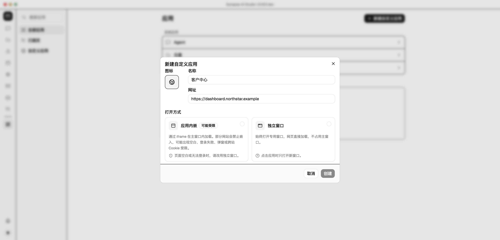
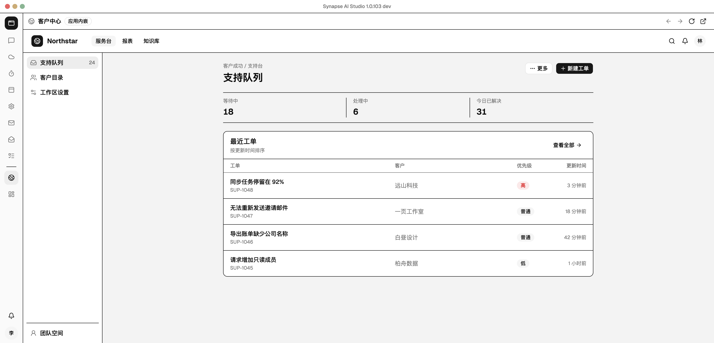
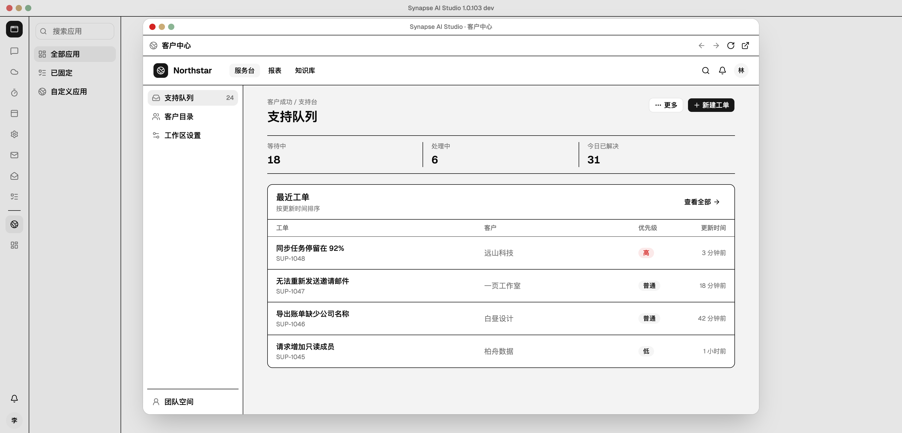

# 自定义应用打开方式交互原型

直接打开 `index.html`。页面样式、字体、图标和示例网页均已内嵌，无需联网或启动服务。

## 预览







## 产品方向

- 新建自定义应用时必须选择打开方式，不在创建后再静默切换。
- “应用内嵌”使用 iframe 在主窗口中加载，并明确提示可能受网站嵌入策略、登录、弹窗和 Cookie 限制。
- “独立窗口”只在专用窗口中打开。窗口顶部提供后退、前进、刷新和在浏览器中打开。
- 两种方式的应用条目都可固定到 Dock；独立窗口模式从应用中心和 Dock 打开时都不会占用主窗口内容区。

## 演示路径

1. 首次打开显示“新建自定义应用”弹窗，先选择“应用内嵌”并创建。
2. 查看主窗口中的 iframe 预览，后退和前进会保持禁用，并提示受嵌入模式限制。
3. 点击 Dock 的“应用”，重新新建并选择“独立窗口”。
4. 在专用窗口内切换左侧导航，验证后退、前进、刷新和在浏览器中打开。
5. 点击专用窗口左上角关闭按钮回到应用中心，再点击自定义应用条目，确认它仍然只在独立窗口打开。

## 实现边界

本目录只演示交互与视觉，不修改正式自定义应用数据模型、导航或 WebContents 实现。示例网址使用保留域名 `example`，页面内容为内嵌模拟网页，没有请求远端资源。

```sh
node docs/prototypes/2026-11-07-custom-app-loading-modes/build.mjs
```
