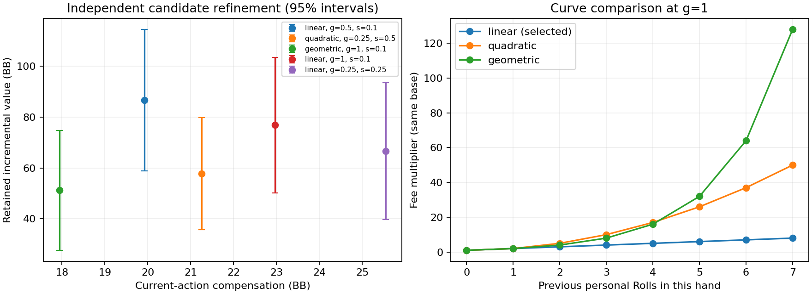
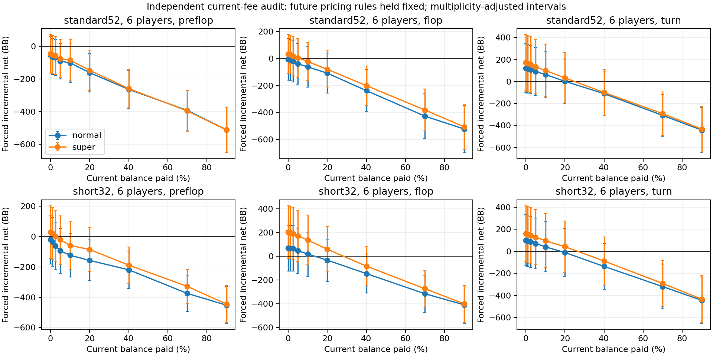

# Roll 牌定价与完整对局模拟研究报告

研究日期：2026-11-01。数据结束：2026-11-01T08:56:46.647Z。

**结论：得到可计算的研究候选公式，但未通过全部验证门槛，不能称为已平衡的正式收费标准。**

固定引擎：`ea48b82ce2ad9d348000732dd233c91403a242c5`。原始配置／代码指纹见 [manifest.json](./manifest.json)，运行结果见 [completion.json](./completion.json)。无产品接入、业务库修改或部署。

## 1. 数学公式与具体参数

对当前操作档位 t，令：

- b 为大盲；P 为本人可争夺的已投入普通筹码；E 为付款前本人还能争夺的对手追加筹码上限。
- n 为仍未弃牌人数，包含全下者；k 为本人本手此前已付费 Roll 次数。
- hN/hS 为其他参与者历史普通／超级次数，分别除以 max(1,n−1)。本人次数不进入这两个量。
- c=(牌组,n,阶段)；具体牌值、候选和私人记牌不进入价格。

```text
R_t = s × (a_t,c × b + p_t,c × P + e_t,c × E) × exp(β_t,N × hN + β_t,S × hS)
A_normal = max(1, R_normal)
A_super  = max(A_normal + 1, R_super)
C_t(k)   = ceil(A_t × M(k))
```

选中尺度 **s=0.1**；曲线族 **linear**；斜率参数 **g=1**。

**M(k)=1+1k**。

两档共用 k。切回普通可降总价；有效筹码变化也可能改变绝对费用。付费后至少留一筹码，付不起时不截断成全部余额。

54 组全部系数见 [coefficients.csv](./coefficients.csv)；完整精度与回退参数见 [recommended-model.json](./recommended-model.json)。以下数字来自测试网格和模型拟合，不是数学上唯一的公允价。

### 典型报价

固定合法起点的公开资金条件，单独改变次数用于展示系数；不是已经连续扣费后的真实余额轨迹。金额为筹码。

|牌组|人数|阶段|大盲|P|E|普通 k=0/1/2/3|超级 k=0/1/2/3|
|---|---:|---|---:|---:|---:|---|---|
|standard52|2|preflop|2|3|198|2 / 3 / 5 / 6|4 / 7 / 11 / 14|
|standard52|2|flop|2|4|198|1 / 2 / 3 / 4|2 / 4 / 6 / 8|
|standard52|2|turn|2|4|198|1 / 2 / 3 / 4|2 / 4 / 6 / 8|
|standard52|6|preflop|2|3|997|1 / 2 / 3 / 4|2 / 4 / 6 / 8|
|standard52|6|flop|2|12|990|1 / 2 / 3 / 4|2 / 4 / 6 / 8|
|standard52|6|turn|2|12|990|1 / 2 / 3 / 4|2 / 4 / 6 / 8|
|standard52|10|preflop|2|3|1797|2 / 3 / 4 / 5|3 / 5 / 7 / 9|
|standard52|10|flop|2|20|1782|2 / 3 / 4 / 5|4 / 7 / 11 / 14|
|standard52|10|turn|2|20|1782|1 / 2 / 3 / 4|3 / 6 / 9 / 12|
|short32|2|preflop|2|3|198|2 / 3 / 4 / 5|3 / 5 / 7 / 9|
|short32|2|flop|2|4|198|1 / 2 / 3 / 4|6 / 11 / 16 / 21|
|short32|2|turn|2|4|198|2 / 3 / 5 / 6|4 / 8 / 12 / 16|
|short32|6|preflop|2|3|997|1 / 2 / 3 / 4|2 / 4 / 6 / 8|
|short32|6|flop|2|12|990|3 / 5 / 7 / 9|4 / 8 / 12 / 16|
|short32|6|turn|2|12|990|1 / 2 / 3 / 4|4 / 7 / 10 / 13|
|short32|10|preflop|2|3|1797|1 / 2 / 3 / 4|2 / 4 / 6 / 8|
|short32|10|flop|2|20|1782|2 / 3 / 4 / 6|3 / 5 / 7 / 10|
|short32|10|turn|2|20|1782|2 / 3 / 4 / 5|4 / 7 / 10 / 13|

### 精确概率与补偿恒等式

以下是精确组合概率，不是模拟EV或定价比例。固定保留一张K、替换非K；对手最初随机持牌、无人另行操作、不开公共牌，命中另外3张K之一就停止。D为牌组总数、N=6、U=D−2、L=D−2N，剩余目标数S服从Hypergeom(U,3,L)。条件于S=s，普通失败率1−s/L，超级失败率C(L−s,3)/C(L,3)。连续a次普通、b次超级的累计命中率为1−ΣPr(S=s)×(1−s/L)^a×[C(L−s,3)/C(L,3)]^b。

|牌组|一次普通|三次普通|一次超级|三次超级|
|---|---:|---:|---:|---:|
|52|6.0000%|16.8601%|17.2704%|42.8279%|
|32|10.0000%|26.6788%|27.9557%|60.3089%|

补偿总额严格等于C：m名合资格对手各获floor(C/m)，余数C mod m按庄家左侧起的资格顺序各加1。费用不进普通底池；先普通派彩，再释放冻结补偿。最低收费、至少留一筹码、等权归一化max-min目标是公开设计取舍；全文EV与置信区间是有限模拟估计，不能与精确概率混称。

## 2. 抽样、策略与价格选择

训练数据 110592 条配对场景；初筛 45 个候选，再用独立种子复评 5 个候选。选参前未读取最终检验样本。

基础回归用一次干预并关闭未来 Roll 的完整正常下注结局作启发式初始化，保留全部正负样本，不使用最好牌或最高收益样本定价。超级只在随机三个候选中按可见牌策略选择；完整后续下注、边池、他人 Roll、本人继续操作及冻结补偿在候选校准与最终检验中开放并进入结局；不能把初始化称为多次策略价值的精确拟合。

四类有限下注／停止策略及参数见 manifest；同类与混合对手均有覆盖。它们不是完整贝叶斯或GTO策略。相同随机未来牌优先序仅用于合法耦合，不把已被换走的牌继续发为公共牌。

选择目标是归一化后最大化“付款方保留的平均增量价值”和“本行动点给对手的新补偿”两项中的较小值；没有用使用率调参。两项等权属于产品设计取舍，不是概率定律。

### 附近候选与价格区间

下表为独立复评的离散候选。尺度范围是已试候选范围，不是统计意义的公允价格置信区间；若最终门槛失败，这些候选均不能称为可上线区间。固定公开条件可直接代入各模型报价。

|曲线|增长参数|尺度|全部机会保留增量BB ±95%半宽|当前补偿BB|归一化max-min分数|
|---|---:|---:|---|---:|---:|
|linear|0.5|0.1|86.654 ± 27.855|19.924|0.780|
|quadratic|0.25|0.5|57.746 ± 21.981|21.259|0.666|
|geometric|1|0.1|51.202 ± 23.608|17.942|0.591|
|linear|1|0.1|76.870 ± 26.690|22.969|0.887|
|linear|0.25|0.25|66.614 ± 26.888|25.544|0.769|



抽样权重与计算预算：

54个主要分组等权；每组深度10/25/50/100/250/500/1000/2500 BB轮换，均匀／短筹码／深筹码／已有全下四种形状轮换，四种同类对手加混合对手轮换。单挑已全下后无行动点的形状以合法均匀起点替代。它是公开的研究分布，不是从真人数据拟合的使用分布。

起点由公开check/call及每个更早阶段至多一次公开尺度加注的合法暖场轨迹获得；既有Roll按覆盖规则安排，不能称为自然玩家先手行为分布。四类下注／停止策略用于完整续局。每起点每条分支完成一次随机结局，未用无限内层求解；可见牌机会按全部未知牌及随机三张的组合分布计算有限特征。NNLS最多80轮，逻辑动作保护上限20000，整手bootstrap400次、种子77121；动作上限触发会失败，不把截断收益纳入研究。全部参数与种子派生代码随源码指纹保存。

训练／固定检验隔离审计：

- 训练 110592 条，固定检验 110592 条；同组种子内部重复分别 0／0，跨集交集 0。候选校准刻意共用随机数，不属于训练／最终检验混用。
- 跨阶段按牌组、原始入座人数和初始种子识别底层手牌，训练／固定各自重复 0／0，两集交集 0；固定集全部32位种子重复 0。训练中有 14 次跨不同牌组／人数的种子复用，未把它们冒充相同手牌或最终检验数据。


## 3. 正式固定样本检验

每组固定 2048 条，共 **110592** 条。自适应新增样本不进入本节，避免改变组权重或停止偏差。单位为大盲 BB。

|指标|数量|平均增量净收益 ± 近似95%半宽|分层整手bootstrap 95%区间|
|---|---:|---|---|
|所有机会（未选当前Roll为零）|110592|75.966 ± 6.567|[69.626, 82.382]|
|当前自主选择Roll|84913|98.939 ± 8.546|[90.464, 107.196]|
|当前选择普通|11180|67.302 ± 21.414|[45.987, 88.569]|
|当前选择超级|73733|103.736 ± 9.291|[94.537, 112.003]|

当前操作点平均给对手补偿 **21.231 BB**。付款方正式净收益门槛：**通过**；校准阶段门槛：**通过**。

这些数值是相对“现在正常出牌、以后仍可Roll”的配对增量，不是绝对赢池率或账号投资收益。随机失败、坏的候选及亏损样本都保留。

当前自选者有 **50.65%** 的单次配对续局增量为负；这是完整随机续局结果，不等同于“抽到坏牌”的概率，也不能保证付费后一定赚回费用。

### 完整续局增量与补偿分布

以下为当前自选Roll者的经验分位数，单位BB；补偿是本行动点全部新费用，等额确权给对手。它与付款方配对增量不是同一个随机变量，不相加解释为总福利。

|指标|5%|25%|中位数|75%|95%|
|---|---:|---:|---:|---:|---:|
|付款方完整续局增量|-804.260|-27.500|-0.250|43.150|1317.970|
|当前行动点补偿|0.500|2.250|7.000|22.000|120.770|
|付款方剩余手牌全部费用|0.500|2.800|8.500|28.800|169.720|

最差五条固定检验样本，保留失败而不当作模型最优价。可用表中的完整ID执行单条重放：

|样本ID|筹码深度BB|策略|进入次数|本行动Roll数|当前费用BB|增量净收益BB|
|---|---:|---|---:|---:|---:|---:|
|final-holdout:short32:9:turn:1879|2500|mixed|3|5|6.000|-22373.600|
|final-holdout:short32:10:flop:1807|2500|loose|0|1|25.100|-20130.400|
|final-holdout:short32:9:flop:1599|2500|mixed|3|3|1.500|-19682.400|
|final-holdout:short32:9:turn:1231|2500|tight|2|3|1.200|-17628.050|
|final-holdout:short32:7:turn:1207|2500|loose|0|3|308.800|-17078.200|

### 独立统计复核

Python／NumPy 1.26.4 单独实现分组固定权重、整手重采样，PCG64种子2026110191、1000次。它没有参与选参，也不替换原先冻结的JS检验；两种实现的均值与标准误一致，有限bootstrap区间存在正常的抽样差异。

|指标|平均增量BB|独立整手bootstrap 95%区间BB|
|---|---:|---|
|all|75.966|[69.807, 83.035]|
|chosen|98.939|[90.894, 108.113]|
|normal|67.302|[44.654, 89.016]|
|super|103.736|[94.463, 112.853]|

## 4. 精度诊断与覆盖

自适应补样后 1769472 条，0/54 组达到均值误差目标。诊断按每组两档及 5 次预定观察作 Bonferroni 正态近似校正，z=2.807034；不宣称54组联合95%覆盖。

目标是半宽 ≤ max(平均报价10%,0.25 BB)，仅约束分组均值的 Monte Carlo 误差，不代表个人牌面误差或模型预测误差。未达到的组不按“已平衡”宣传。

|分组|总样本|普通可付费样本|普通净增量±诊断半宽|超级可付费样本|超级净增量±诊断半宽|达标|
|---|---:|---:|---|---:|---|---|
|standard52:2:preflop|32768|32675|-10.786 ± 10.419|32515|-4.529 ± 10.393|否|
|standard52:2:flop|32768|32669|24.305 ± 11.972|32437|23.791 ± 12.031|否|
|standard52:2:turn|32768|32689|5.395 ± 11.741|32534|16.704 ± 11.704|否|
|standard52:3:preflop|32768|32723|2.721 ± 15.000|32621|4.830 ± 14.904|否|
|standard52:3:flop|32768|32689|23.050 ± 14.941|32576|28.241 ± 14.927|否|
|standard52:3:turn|32768|32708|9.774 ± 13.880|32581|22.568 ± 14.093|否|
|standard52:4:preflop|32768|32352|32.987 ± 18.514|32287|35.312 ± 18.536|否|
|standard52:4:flop|32768|32717|52.567 ± 18.127|32470|63.152 ± 18.651|否|
|standard52:4:turn|32768|32721|88.905 ± 19.798|32633|99.794 ± 19.987|否|
|standard52:5:preflop|32768|32740|6.297 ± 14.587|32695|7.609 ± 15.096|否|
|standard52:5:flop|32768|32717|42.402 ± 19.909|32655|55.171 ± 20.141|否|
|standard52:5:turn|32768|32723|140.117 ± 22.882|32236|153.179 ± 23.487|否|
|standard52:6:preflop|32768|32750|32.880 ± 14.483|32704|40.088 ± 15.066|否|
|standard52:6:flop|32768|32723|36.961 ± 20.550|32660|42.609 ± 20.976|否|
|standard52:6:turn|32768|32608|189.999 ± 23.902|32479|207.120 ± 24.048|否|
|standard52:7:preflop|32768|32754|122.978 ± 20.321|32714|129.231 ± 20.661|否|
|standard52:7:flop|32768|32740|22.708 ± 19.718|32680|26.763 ± 19.867|否|
|standard52:7:turn|32768|32738|200.662 ± 22.656|32683|207.205 ± 22.737|否|
|standard52:8:preflop|32768|32754|109.258 ± 19.751|32725|109.012 ± 19.565|否|
|standard52:8:flop|32768|32690|96.874 ± 20.075|32213|97.569 ± 20.606|否|
|standard52:8:turn|32768|32690|169.566 ± 20.986|32169|162.614 ± 21.070|否|
|standard52:9:preflop|32768|32757|12.721 ± 11.543|32736|30.936 ± 13.233|否|
|standard52:9:flop|32768|32750|103.162 ± 19.346|32726|107.401 ± 19.441|否|
|standard52:9:turn|32768|32745|202.695 ± 22.253|32359|216.196 ± 22.876|否|
|standard52:10:preflop|32768|32756|46.512 ± 15.822|32741|68.343 ± 17.142|否|
|standard52:10:flop|32768|32477|50.816 ± 17.788|32231|61.526 ± 18.479|否|
|standard52:10:turn|32768|32744|215.731 ± 21.758|32714|221.473 ± 22.066|否|
|short32:2:preflop|32768|32543|-6.331 ± 10.468|32409|4.043 ± 10.480|否|
|short32:2:flop|32768|32713|19.163 ± 12.014|31388|20.382 ± 12.571|否|
|short32:2:turn|32768|32678|-4.422 ± 10.311|32485|7.833 ± 10.079|否|
|short32:3:preflop|32768|32719|-12.086 ± 14.294|32622|-10.918 ± 14.852|否|
|short32:3:flop|32768|32704|38.124 ± 16.482|32265|57.526 ± 16.608|否|
|short32:3:turn|32768|32711|48.081 ± 16.013|32512|55.794 ± 15.845|否|
|short32:4:preflop|32768|32739|-17.395 ± 14.367|32684|-6.695 ± 15.407|否|
|short32:4:flop|32768|32722|22.672 ± 18.358|32642|48.802 ± 18.541|否|
|short32:4:turn|32768|32717|64.351 ± 19.752|32617|72.968 ± 19.857|否|
|short32:5:preflop|32768|32727|-23.184 ± 15.492|32675|-17.747 ± 15.861|否|
|short32:5:flop|32768|32729|23.115 ± 21.092|32645|31.492 ± 21.078|否|
|short32:5:turn|32768|32486|176.631 ± 24.142|31281|183.502 ± 24.927|否|
|short32:6:preflop|32768|32750|38.316 ± 20.816|32701|38.622 ± 20.485|否|
|short32:6:flop|32768|32721|47.697 ± 21.780|32668|62.019 ± 22.628|否|
|short32:6:turn|32768|32728|189.557 ± 26.018|32661|197.599 ± 26.496|否|
|short32:7:preflop|32768|32754|2.059 ± 12.560|32721|11.314 ± 14.945|否|
|short32:7:flop|32768|32724|93.243 ± 23.178|32347|98.622 ± 23.747|否|
|short32:7:turn|32768|32738|179.519 ± 27.579|32640|175.132 ± 28.035|否|
|short32:8:preflop|32768|32752|48.278 ± 20.632|32714|68.325 ± 20.980|否|
|short32:8:flop|32768|31259|6.753 ± 23.231|31194|52.082 ± 25.374|否|
|short32:8:turn|32768|31755|252.144 ± 32.844|30494|278.329 ± 34.794|否|
|short32:9:preflop|32768|32753|-4.205 ± 16.913|32728|6.149 ± 17.624|否|
|short32:9:flop|32768|32745|127.484 ± 26.418|32682|133.321 ± 26.733|否|
|short32:9:turn|32768|32749|287.443 ± 33.368|32718|276.866 ± 32.932|否|
|short32:10:preflop|32768|32757|32.801 ± 17.149|32727|37.578 ± 17.251|否|
|short32:10:flop|32768|32736|36.916 ± 22.496|32696|59.372 ± 23.352|否|
|short32:10:turn|32768|32742|160.832 ± 28.470|32285|167.876 ± 29.512|否|

固定样本覆盖：已全下对手 25623 条、产生边池 80445 条、已有弃牌参与者 18330 条。HU在已匹配全下后没有新的转牌行动点，研究没有伪造这种机会。

### 牌面、深度与策略分层

以下来自固定检验样本，分层只作诊断，不回流调参，也不进入报价。小分层的区间不作同时显著性结论。

|分层|数量|自选数量|自选增量净收益 ± 近似95%半宽|
|---|---:|---:|---|
|texture=paired\|max-suit-1\|connected|810|662|377.473 ± 165.163|
|texture=paired\|max-suit-1\|disconnected|5441|4437|230.243 ± 44.427|
|texture=paired\|max-suit-2\|connected|4733|3839|258.935 ± 55.623|
|texture=paired\|max-suit-2\|disconnected|10608|8808|270.100 ± 30.482|
|texture=paired\|max-suit-3\|connected|791|611|236.334 ± 166.474|
|texture=paired\|max-suit-3\|disconnected|947|785|177.233 ± 96.659|
|texture=preflop|36864|28479|48.588 ± 12.010|
|texture=unpaired\|max-suit-1\|connected|5878|4395|43.765 ± 32.777|
|texture=unpaired\|max-suit-1\|disconnected|6863|5002|24.110 ± 26.921|
|texture=unpaired\|max-suit-2\|connected|18210|13600|74.138 ± 22.041|
|texture=unpaired\|max-suit-2\|disconnected|13293|9704|-6.543 ± 22.685|
|texture=unpaired\|max-suit-3\|connected|3862|2891|200.351 ± 60.105|
|texture=unpaired\|max-suit-3\|disconnected|1995|1558|150.462 ± 76.259|
|texture=unpaired\|max-suit-4\|connected|218|102|46.345 ± 212.114|
|texture=unpaired\|max-suit-4\|disconnected|79|40|331.774 ± 410.153|
|depth=10|13824|9831|0.967 ± 0.245|
|depth=100|13824|11326|20.638 ± 2.517|
|depth=1000|13824|10283|223.538 ± 27.061|
|depth=25|13824|10396|4.354 ± 0.640|
|depth=250|13824|11213|52.085 ± 6.171|
|depth=2500|13824|10020|405.950 ± 64.564|
|depth=50|13824|10709|10.150 ± 1.239|
|depth=500|13824|11135|94.629 ± 12.463|
|profile=adaptive|22086|17078|118.236 ± 21.246|
|profile=conservative|22140|16688|3.669 ± 1.865|
|profile=loose|22140|17351|183.274 ± 24.141|
|profile=mixed|22086|16849|104.244 ± 21.639|
|profile=tight|22140|16947|81.687 ± 17.159|
|count=0|55516|46003|78.192 ± 9.604|
|count=1|27748|21656|109.900 ± 17.322|
|count=2|13558|7246|82.275 ± 34.642|
|count=3|13770|10008|182.650 ± 35.659|

### 基础估值迁移残差诊断

仅使用固定检验中本人次数为0且可支付的强制操作。预测值是未缩放的训练初始化基础估值；观测代理是实际收费下的完整续局增量再加回本次费用。后者包含未来下注与Roll，且费用改变了资金和策略，不能视为零费下真实机会价值。单次随机结局还带来大量噪声，因此MAE/RMSE不是精确EV预测误差；本研究未单独识别每个私牌的真实EV误差。均值残差和分组均值精度也不能代替它。

|档位|样本|观测代理−初始化预测的均值BB ±95%半宽|MAE BB|RMSE BB|
|---|---:|---|---:|---:|
|normal|55499|44.752 ± 8.632|293.567|1038.434|
|super|55329|33.735 ± 8.597|304.740|1032.280|

### 预算与方差

按最终观测方差、相同平均报价目标及当前可付费比例折算总起点预算，每组达到两档精度所需起点数的中位数约 117,505,227，范围约 5,732,517–583,745,406。这不是新的通过标准或保证，方差、可付费比例与报价均仍有估计误差；这里只解释深筹码混合对局为何可能在32,768上限仍证据不足。不能为了让这个数变小而把收费抬高。

### 补样中的重复种子与整手聚类复核

自适应全部数据发现 7 个组内重复32位种子簇；未删除或悄悄重抽。正式固定2048/组没有这些重复，正式检验仍只用固定样本。另保存 [cluster-audit.json](./cluster-audit.json)，按组内实际手牌种子聚类计算完整均值的稳健标准误，使用G/(G−1)修正、原Bonferroni z和原收费误差目标，0/54 组达标，未覆盖原冻结结果或改动价格。

上方精度表保留原冻结的正态近似诊断，重复簇复核是事后质量检查，不是从多个区间中挑选通过者。两种诊断均不能认证当前模型。下一轮需扩大种子／随机状态空间并在最终抽样前检查独立手牌标识；本次保留全部重复记录及其ID。

### 原始资本与逐步账本样例

正式样本 `final-holdout:standard52:6:flop:0` 用原冻结内核重放，与原始结果逐字段一致。4个状态分支（含起点暖场，3个完成结算）共120条状态记录全部保持原始资本守恒；105条记录仍有正的冻结补偿，3条已派彩但尚未释放。见 [逐步资金账本](./audit-trace.jsonl) 和 [重放校验](./replay-verification.json)。这些审计信息只属于合成研究观测器，不交给策略。

## 5. 他人先Roll的影响

控制实验从手牌开始分配不同资本并重放同一合法轨迹，以精确匹配当前本人筹码、有效底池和有效未来筹码；没有中途充值。整体分支保留实际费用造成的资金变化。相应原始数据和摘要分别保存，不能把匹配条件下的结果叫作普适因果效应。

|他人历史 / 本次档位|样本|匹配资金后的毛机会价值变化 BB ±95%半宽|含资金变化的整体变化 BB ±95%半宽|方向证据|
|---|---:|---|---|---|
|normal:normal|6912|-35.402 ± 65.449|-36.616 ± 65.445|unresolved|
|normal:super|6912|-6.824 ± 65.409|-8.057 ± 65.410|unresolved|
|super:normal|6912|-18.844 ± 65.532|-23.279 ± 65.285|unresolved|
|super:super|6912|-58.859 ± 65.779|-56.147 ± 65.783|unresolved|
|normal-super:normal|7680|-94.048 ± 61.151|-86.104 ± 60.932|negative|
|normal-super:super|7680|-72.923 ± 63.516|-62.008 ± 63.110|negative|
|mixed-then-fold:normal|6144|-43.878 ± 65.557|-43.878 ± 65.557|unresolved|
|mixed-then-fold:super|6144|5.207 ± 66.373|5.207 ± 66.373|unresolved|

### 实际应用的历史系数

|本次档位:先前档位|估计β|多重比较校正区间|实际应用β|
|---|---:|---|---:|
|normal:normal|-3.429687|[-8.459194, 1.599820]|0.000000|
|normal:super|-1.108287|[-6.724150, 4.507576]|0.000000|
|super:normal|-0.015570|[-1.998574, 1.967434]|0.000000|
|super:super|0.050544|[-2.036438, 2.137527]|0.000000|

历史修正跨零时应用0，表示没有足够证据另收费用，**不表示证明历史没有影响**。即使显式历史系数为0，对手付款减少可争夺筹码、或有人弃牌改变人数，也可能通过基础价影响后续报价；不存在机械的全桌第几次涨价。

### 多人先后操作的独立控制实验

额外 12288 条档位干预结果（每个起点两档），3–10人、两种牌组和三阶段。两至三名先手依次操作，覆盖单次、连续混档及最后一名先手弃牌；从入座时的初始资本求解资金匹配，不中途充值。未用于拟合历史系数；仅作独立诊断，不因该样本的正负点估计追加价格项。两档共享起点，但每行只聚合一种干预，未把两档当成独立观察来缩小区间。

|先手模式 / 本次档位|起点数|匹配资金后机会价值变化BB ±95%半宽|含真实资金变化的整体变化BB ±95%半宽|
|---|---:|---|---|
|2actors-normal/super:normal|1536|-125.099 ± 150.373|-130.047 ± 150.568|
|2actors-normal/super:super|1536|-117.436 ± 147.902|-124.758 ± 149.839|
|2actors-super+super/normal+normal:normal|1536|-4.928 ± 131.605|7.530 ± 134.537|
|2actors-super+super/normal+normal:super|1536|-1.745 ± 129.131|18.290 ± 132.983|
|2actors-normal+super/super+normal-then-fold:normal|1728|-59.919 ± 126.572|-53.822 ± 127.736|
|2actors-normal+super/super+normal-then-fold:super|1728|-121.542 ± 134.561|-120.281 ± 134.322|
|3actors-normal/super/normal+super-then-fold:normal|1344|-68.095 ± 141.992|-62.718 ± 142.463|
|3actors-normal/super/normal+super-then-fold:super|1344|-24.593 ± 152.107|-18.320 ± 152.516|

分组多重比较未作整体显著性宣称。精确匹配的是目标玩家当前报价使用的公开资金与次数；不同初始资本、冻结补偿和先手牌力仍是受控历史的一部分。无法据此识别所有真人行为下纯粹的历史因果效应。

历史控制实验的起点只用25/100/500/2500 BB和均匀初始筹码，目标玩家此前本人次数为0；主研究另覆盖其他深度、悬殊筹码与本人次数。不能把条件历史结果外推成这些维度上的精确因果结论。整体分支按真实余额与资格执行先手计划，付不起后停止；表中模式指安排的先手策略，不保证整体分支实际完成每次操作。资金匹配分支才严格完成全部指定序列。

## 6. 连续顺序与停止

四种策略使用同一初始样本和对应的立即正常出牌基线，起档相对本次实验起点，不由已有次数奇偶偷换。是否继续由可见牌策略、价格与真实筹码预算共同决定；没有把无限使用都做成正收益。

|模式|样本|当前自选数|当前自选净增量 ±95%半宽|当前补偿 BB|当前平均Roll次数|
|---|---:|---:|---|---:|---:|
|normal|13824|8404|69.961 ± 26.170|11.752|2.605|
|super|13824|10277|91.373 ± 24.486|20.560|1.859|
|normal-super|13824|8404|89.739 ± 26.401|14.925|1.723|
|super-normal|13824|10277|59.990 ± 23.348|14.997|1.622|

### 当前行动点的实际停止位置

次数为进入行动点的本手累计数加本行动点新增数；包括选择立即停止的机会。这里只报告停止位置，未把停止原因推断成资金不足或理性最优。不同策略的参数及深度分层另列，有限策略不保证每一个次数分层都盈利。

|行动点结束时累计次数|机会数|当前自选数|自选净增量BB ±95%半宽|
|---|---:|---:|---|
|0|9513|0|0.000 ± 不可估计|
|1|21863|15771|51.644 ± 15.015|
|2|25026|18714|97.254 ± 16.807|
|3|18335|14573|103.435 ± 21.257|
|4|13017|13017|120.410 ± 24.914|
|5–9|18456|18456|122.711 ± 20.205|
|10+|4382|4382|97.494 ± 40.362|

### 四种全桌后续模式的配对比较

上表的每种模式都使用自身的未来模式作为正常出牌基线，且自选者集合可能不同，不能据其条件增量直接给模式排名。模式约束同时作用于全桌参与者，不是只改变当前付款方而固定其他人的策略。下表改为同一合法起点、全部机会的最终余额配对差，以“从本起点全桌只用普通Roll”的路径为参照；先前已发生的覆盖历史相同。它包括停止、未来下注、全部费用与补偿，仅为独立诊断，不回流选价或充当新的正式门槛，也不识别付款方个人顺序的纯粹因果效应。

|模式|整手配对数|相对普通模式最终余额差BB ±95%半宽|单手差值为负比例|
|---|---:|---|---:|
|normal|13824|0.000 ± 0.000|0.00%|
|super|13824|21.408 ± 20.411|48.98%|
|normal-super|13824|7.137 ± 17.835|43.24%|
|super-normal|13824|-7.209 ± 18.457|51.20%|

### 只改变本人模式，对手保持自适应

另用 13824 个独立合法起点，固定对手的下注／停止风格及档位选择函数，仅改变当前付款方的后续允许模式；对手的Roll档位模式始终为adaptive（两档自主比较），仍按实际状态正常反应，下注风格保留同类与混合分配。参考路径是本人本手余下不再Roll，因而测量整套个人策略价值，区别于正式检验“现在正常行动，以后保留机会”的单次选择价值。未用于选价。每个汇总对5个模式对照使用Bonferroni正态近似区间（z=2.575829），不宣称所有次数分层联合覆盖。

|本人模式|起点数|相对本人不再Roll的净增量BB ±校正半宽|本手余下费用BB|本手余下Roll次数|单手负增量比例|
|---|---:|---|---:|---:|---:|
|none|13824|0.000 ± 0.000|0.000|0.000|0.00%|
|normal|13824|45.261 ± 19.306|22.947|2.931|41.72%|
|super|13824|62.800 ± 23.010|34.731|1.833|45.41%|
|normal-super|13824|42.399 ± 19.924|26.514|1.864|40.96%|
|super-normal|13824|44.260 ± 20.760|25.997|1.739|47.46%|
|adaptive|13824|71.835 ± 23.562|35.603|2.343|47.22%|

按进入行动点时本人次数分层；停止众数是本行动点结束时的累计次数，不是永久停止或最优停止。先前实际付费Roll可能改变牌力，不能把这些分层差异全归因于加价。

|进入次数|本人模式|起点数|整手增量BB ±校正半宽|本行动点停止次数众数|
|---:|---|---:|---|---:|
|0|normal|3456|32.282 ± 38.383|0|
|0|super|3456|73.996 ± 50.238|1|
|0|normal-super|3456|38.057 ± 39.997|0|
|0|super-normal|3456|49.563 ± 46.438|1|
|0|adaptive|3456|74.763 ± 49.765|1|
|1|normal|3534|40.689 ± 38.808|1|
|1|super|3534|56.953 ± 43.956|1|
|1|normal-super|3534|26.819 ± 39.732|1|
|1|super-normal|3534|53.245 ± 40.206|2|
|1|adaptive|3534|67.387 ± 45.491|2|
|2|normal|3448|54.165 ± 34.793|2|
|2|super|3448|43.939 ± 38.096|2|
|2|normal-super|3448|58.190 ± 36.167|2|
|2|super-normal|3448|17.859 ± 32.792|2|
|2|adaptive|3448|68.962 ± 41.380|2|
|3|normal|3386|54.211 ± 42.218|3|
|3|super|3386|76.683 ± 50.857|3|
|3|normal-super|3386|47.012 ± 43.293|3|
|3|super-normal|3386|56.355 ± 45.397|4|
|3|adaptive|3386|76.415 ± 51.434|3|

## 7. 本次费用收支平衡扫描

独立 27648 个起点，27648 个有能力付正费用。只改变当前一次费用；后续价格模型参数固定，但未来报价仍随合法资金状态更新。扫描当前剩余筹码的0%、1%、2.5%、5%、10%、20%、40%、70%、90%，完整续局到结束，不丢弃负收益。

每组两档九个费用点作 Bonferroni 正态近似诊断。表中 BB 为各手按余额比例支付费用的均值，过零区间属于这一比例收费政策的强制尝试平均净增益曲线，不是单一固定 BB 收费的精确根，也不能直接与公式平均报价比大小来判定合理性。线性插值不是按最佳私牌推算的价格，也不是每个玩家的精确愿付上限。自主选择有利局面的正式收益另见第3节。

|分组|档位|可付费起点|当前公式平均报价BB|扫描过零费用区间BB|线性插值BB|端点符号有校正置信支持|
|---|---|---:|---:|---|---:|---|
|standard52:2:preflop|normal|512|2.594|全部点估计非正|—|否|
|standard52:2:preflop|super|512|5.828|全部点估计非正|—|否|
|standard52:2:flop|normal|512|0.598|全部点估计非正|—|否|
|standard52:2:flop|super|512|4.809|[0.000, 6.201]|4.029|否|
|standard52:2:turn|normal|512|1.078|全部点估计非正|—|否|
|standard52:2:turn|super|512|4.521|[0.000, 6.051]|4.092|否|
|standard52:3:preflop|normal|512|0.722|[0.000, 6.531]|5.044|否|
|standard52:3:preflop|super|512|3.533|[32.898, 65.999]|44.327|否|
|standard52:3:flop|normal|512|0.890|全部点估计非正|—|否|
|standard52:3:flop|super|512|3.574|[14.245, 28.661]|18.507|否|
|standard52:3:turn|normal|512|1.820|全部点估计非正|—|否|
|standard52:3:turn|super|512|6.647|[15.818, 31.813]|31.065|否|
|standard52:4:preflop|normal|512|1.448|全部点估计非正|—|否|
|standard52:4:preflop|super|512|1.948|全部点估计非正|—|否|
|standard52:4:flop|normal|512|0.500|[30.371, 61.048]|50.192|否|
|standard52:4:flop|super|512|3.001|[61.048, 122.500]|68.430|否|
|standard52:4:turn|normal|512|0.917|[60.904, 122.145]|120.425|否|
|standard52:4:turn|super|512|4.135|[0.000, 5.962]|5.426|否|
|standard52:5:preflop|normal|512|0.910|[58.683, 117.543]|102.078|否|
|standard52:5:preflop|super|512|3.948|[58.683, 117.543]|82.211|否|
|standard52:5:flop|normal|512|2.125|[60.384, 121.181]|73.682|否|
|standard52:5:flop|super|512|2.625|[60.384, 121.181]|82.357|否|
|standard52:5:turn|normal|512|0.540|[58.108, 116.461]|112.517|否|
|standard52:5:turn|super|512|1.719|[58.108, 116.461]|84.720|否|
|standard52:6:preflop|normal|512|0.727|全部点估计非正|—|否|
|standard52:6:preflop|super|512|1.227|全部点估计非正|—|否|
|standard52:6:flop|normal|512|2.313|全部点估计非正|—|否|
|standard52:6:flop|super|512|2.813|[29.942, 60.194]|36.888|否|
|standard52:6:turn|normal|512|1.829|[112.729, 225.729]|115.062|否|
|standard52:6:turn|super|512|2.329|[112.729, 225.729]|141.254|否|
|standard52:7:preflop|normal|512|0.523|[14.662, 29.436]|25.994|否|
|standard52:7:preflop|super|512|1.023|[29.436, 58.997]|53.027|否|
|standard52:7:flop|normal|512|3.494|[14.046, 28.270]|17.036|否|
|standard52:7:flop|super|512|6.426|全部点估计非正|—|否|
|standard52:7:turn|normal|512|0.992|[115.364, 231.063]|134.939|否|
|standard52:7:turn|super|512|3.554|[115.364, 231.063]|165.548|否|
|standard52:8:preflop|normal|512|0.537|[236.001, 413.035]|264.081|否|
|standard52:8:preflop|super|512|2.267|[117.946, 236.001]|234.720|否|
|standard52:8:flop|normal|512|0.500|[29.387, 59.082]|38.264|否|
|standard52:8:flop|super|512|2.416|[59.082, 118.566]|85.670|否|
|standard52:8:turn|normal|512|1.265|[109.468, 219.312]|125.879|否|
|standard52:8:turn|super|512|9.835|[54.541, 109.468]|100.587|否|
|standard52:9:preflop|normal|512|3.287|[28.992, 58.097]|50.032|否|
|standard52:9:preflop|super|512|4.311|[58.097, 116.289]|98.493|否|
|standard52:9:flop|normal|512|0.500|[13.822, 27.833]|27.366|否|
|standard52:9:flop|super|512|2.374|[27.833, 55.979]|38.930|否|
|standard52:9:turn|normal|512|1.377|[232.343, 406.651]|282.966|否|
|standard52:9:turn|super|512|5.074|[232.343, 406.651]|283.284|否|
|standard52:10:preflop|normal|512|3.045|[13.993, 28.065]|26.445|否|
|standard52:10:preflop|super|512|3.552|[28.065, 56.246]|52.706|否|
|standard52:10:flop|normal|512|2.113|全部点估计非正|—|否|
|standard52:10:flop|super|512|5.688|全部点估计非正|—|否|
|standard52:10:turn|normal|512|1.180|[111.155, 222.580]|198.993|否|
|standard52:10:turn|super|512|7.799|[111.155, 222.580]|203.698|否|
|short32:2:preflop|normal|512|1.296|全部点估计非正|—|否|
|short32:2:preflop|super|512|1.796|全部点估计非正|—|否|
|short32:2:flop|normal|512|0.500|[6.043, 15.365]|8.897|否|
|short32:2:flop|super|512|2.969|[6.043, 15.365]|9.928|否|
|short32:2:turn|normal|512|3.313|全部点估计非正|—|否|
|short32:2:turn|super|512|8.763|全部点估计非正|—|否|
|short32:3:preflop|normal|512|1.731|[30.201, 60.612]|34.312|否|
|short32:3:preflop|super|512|3.685|[30.201, 60.612]|50.243|否|
|short32:3:flop|normal|512|3.723|[62.009, 124.410]|70.875|否|
|short32:3:flop|super|512|4.887|[62.009, 124.410]|89.299|否|
|short32:3:turn|normal|512|0.734|[30.472, 61.145]|42.261|否|
|short32:3:turn|super|512|7.156|[61.145, 122.520]|66.267|否|
|short32:4:preflop|normal|512|3.315|全部点估计非正|—|否|
|short32:4:preflop|super|512|3.838|全部点估计非正|—|否|
|short32:4:flop|normal|512|7.012|[58.714, 117.842]|103.644|否|
|short32:4:flop|super|512|11.986|[117.842, 235.921]|168.116|否|
|short32:4:turn|normal|512|0.500|[0.000, 5.920]|0.092|否|
|short32:4:turn|super|512|12.379|[60.438, 121.227]|91.002|否|
|short32:5:preflop|normal|512|4.205|全部点估计非正|—|否|
|short32:5:preflop|super|512|6.144|全部点估计非正|—|否|
|short32:5:flop|normal|512|4.813|[123.968, 248.170]|152.439|否|
|short32:5:flop|super|512|12.864|[123.968, 248.170]|147.497|否|
|short32:5:turn|normal|512|1.548|[117.874, 236.014]|124.351|否|
|short32:5:turn|super|512|10.321|[117.874, 236.014]|185.843|否|
|short32:6:preflop|normal|512|0.500|全部点估计非正|—|否|
|short32:6:preflop|super|512|1.000|[14.374, 28.861]|16.278|否|
|short32:6:flop|normal|512|5.478|[56.570, 113.558]|76.374|否|
|short32:6:flop|super|512|10.031|[113.558, 227.353]|160.457|否|
|short32:6:turn|normal|512|0.500|[55.498, 111.336]|99.306|否|
|short32:6:turn|super|512|7.485|[111.336, 222.934]|147.296|否|
|short32:7:preflop|normal|512|1.685|全部点估计非正|—|否|
|short32:7:preflop|super|512|3.229|[14.456, 29.007]|22.238|否|
|short32:7:flop|normal|512|1.661|[57.441, 115.289]|71.481|否|
|short32:7:flop|super|512|5.394|[57.441, 115.289]|103.807|否|
|short32:7:turn|normal|512|0.835|[116.299, 232.941]|135.993|否|
|short32:7:turn|super|512|11.618|[116.299, 232.941]|212.314|否|
|short32:8:preflop|normal|512|0.500|全部点估计非正|—|否|
|short32:8:preflop|super|512|1.040|全部点估计非正|—|否|
|short32:8:flop|normal|512|7.261|[113.422, 227.083]|142.779|否|
|short32:8:flop|super|512|9.343|[56.502, 113.422]|93.615|否|
|short32:8:turn|normal|512|2.783|[218.133, 381.723]|260.947|否|
|short32:8:turn|super|512|5.138|[218.133, 381.723]|293.604|否|
|short32:9:preflop|normal|512|3.802|全部点估计非正|—|否|
|short32:9:preflop|super|512|4.556|全部点估计非正|—|否|
|short32:9:flop|normal|512|0.500|[116.565, 233.369]|171.049|否|
|short32:9:flop|super|512|2.962|[58.076, 116.565]|98.189|否|
|short32:9:turn|normal|512|0.500|[385.145, 495.402]|388.684|否|
|short32:9:turn|super|512|1.000|[220.051, 385.145]|381.263|否|
|short32:10:preflop|normal|512|1.229|[28.913, 57.941]|52.243|否|
|short32:10:preflop|super|512|1.729|[57.941, 115.984]|103.167|否|
|short32:10:flop|normal|512|2.886|[114.567, 229.371]|152.451|否|
|short32:10:flop|super|512|6.273|[114.567, 229.371]|169.638|否|
|short32:10:turn|normal|512|3.278|[228.520, 399.989]|311.909|否|
|short32:10:turn|super|512|10.890|[228.520, 399.989]|291.118|否|

完整九点曲线及非单调／右删失标记见 [break-even-summary.json](./break-even-summary.json)。未出现清晰区间时如实保留，不能把最高费用或最优中奖金额当成公允价格。



## 8. 限制、失败条件与复现

- 这是有限启发式对手与可达合成局面的研究；不承诺真实玩家收益或多人GTO，也没有模拟网络、思考耗时和真实客户端超时。
- 采用均值回归和统一公开价，不能恰好补偿每个私牌的价值。公共牌结构分层诊断和模型残差不能用总体均值置信区间代替。
- 强制操作付不起时原始收益记null，不计入可支付干预均值；自主选择路径仍保留完整结果，没有把付不起者的收益当零后宣称有利。
- 价格曲线只在已测试45个网格候选和独立复评中选择，不声称连续参数空间的全局最优。
- 后续任何根据本次最终数据调整参数的模型，都需要新种子的独立最终检验；不能继续复用本次holdout宣布通过。

复跑、单条重放和数据校验命令见 [研究程序说明](../../../../server/test/poker-roll-research/README.md)。原始数据索引、全部模型、校准与最终结果均保存在本目录，SHA256链见 artifacts.json。产品没有启用Roll，注册项、MCP、数据库与发布流程未改变。

测试、独立审阅及完整数据链执行记录见 [验证记录](./VALIDATION.md)。


计算实现说明：完整批次检查点后使用可见牌力纯函数的精确数值缓存继续。冻结内核、报价、种子、样本上限和正式2048/组未变。768组完整配对结果SHA一致；恢复回归验证新增行与原内核一致。额外执行路径、模型和策略指纹以及旧批次前缀校验见 acceleration-manifest.json 和 memoization-parity.json。

## 9. 未通过门槛后的模型修订

保留原模型与原最终数据，另存 [revision-candidate.json](./revision-candidate.json)。新基础系数改用 27648 个零本次费用、允许完整未来Roll／下注的起点拟合，包含负结果；替代原来关闭未来Roll的初始化。曲线、尺度及历史规则暂保留，未重新宣称最优。

这批独立费用扫描数据现在明确作为新版本训练，未用于原版本选参；新模型状态是 **未验证，仅供下一轮研究**。原holdout不能复用为新模型的独立检验。必须使用新训练／校准与未触及的最终种子，继续保持本次净收益和精度门槛。

精度不足不等于已证明某个具体价格错误；修订不通过抬高费用扩大容许误差，也不保证解决方差。下一轮应按深度固定权重分层、增加每个起点的内层续局以降低均值估计噪声，并重新报告预算内是否达标，不能只放宽断言。