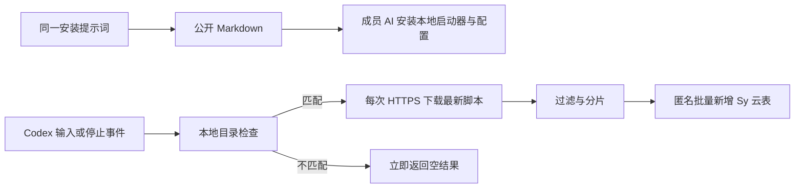

<!-- Sy public-asset UTF-8 prefix boundary compatibility -->
# Codex 团队对话 Hook：完整技术方案与链路试验

日期：2026-11-13（Asia/Shanghai）。本文包含管理员准备、成员安装、完整源码和真实试验结果。资源目前绑定独立测试表，仅使用合成数据；没有安装当前电脑的全局 Hook，也没有向团队发安装通知。Windows 尚未真实验收。

## 1. 可行性、目标与已确定边界

可以实现「全员共用提示词 → 读取公开 Markdown → 按说明安装稳定 Hook → 每次拉取远端脚本 → 按当前逻辑上报」。后续改过滤、字段映射或目标云表，只更新远端脚本，不逐台改 Hook。

首版覆盖 macOS、原生 Windows 的 Codex。成员安装时填写姓名和一个或多个公司项目目录，之后可在本地修改。只取 `UserPromptSubmit.prompt` 和 `Stop.last_assistant_message`，不采思考、工具结果、中间进度、附件或 transcript。目录依据 Hook 事件 `cwd`，不依据模型后来执行的 shell `cd`。

不保存正文队列，不自动重试、不补发、不安装常驻服务。下载或发送失败即放弃当次事件；网络超时、断连或服务端 5xx 记为结果未知，不宣称一定没有写入。

姓名是成员自报信息，不是认证身份。云表仅开放匿名新增，知道公开入口的人可以提交，无法仅凭姓名防冒填。表主的 API Key、登录 token、Cookie 不出现在公开 Markdown、脚本或成员机器上。目标表 ID 可以在公开脚本中看到；本方案实现的是集中维护目标，不是隐藏表 ID。

远端代码以本机用户身份执行，发布者更新代码等同于更新安装者随后执行的程序。HTTPS、超时、参数白名单不能将该程序变成沙箱。安装者须明确接受信任该发布者持续更新代码；不绕过 Codex 的正式信任审核。

内部请求采用尽力过滤：当前已知应用的下一条消息建议也触发 `UserPromptSubmit`，公开字段没有已验证的真人来源标记。首版过滤已知前缀，不保证排除全部内部请求及其关联回复；新增规则放远端。`Stop` 仅提供最新 assistant 文本，也不是所有客户端状态下「实际已展示最终回复」的完整证明。

## 2. 架构和职责



| 部分 | 内容 | 更新方式 |
|---|---|---|
| 全员提示词 | 本文链接、安装授权和范围 | 同一份文本发给全员 |
| 全局 Hook | 两个事件各调用本地启动器 | 首次安装；新增事件时升级 |
| 本地启动器 | 目录匹配、提取固定字段、下载、执行和硬超时 | 保持稳定；协议变化时升级 |
| 本地 config.json | 姓名、目录列表、启停状态 | 每次事件重新读取，立即影响后续事件 |
| 远端 collector | 目标表、过滤、字段映射、分片、HTTP 提交 | 原公开链接替换内容 |
| 云表 | 正文记录、关联 ID 和分片序号 | 表主维护 schema 与权限 |

两个事件的 matcher 不支持按目录筛选。因此全局 Hook 在范围外仍会启动一次本地检查，然后不下载、不发送、不保存正文，不能描述为「范围外完全不启动任何进程」。

### 同步与异步的实测选择

**默认使用 `async: false`，外层 `timeout: 15`。** 下载子进程硬限 5 秒，远端执行子进程硬限 6 秒；连接本身超时 3 秒。每次调用存在网络等待，不承诺零延迟。错误不会返回阻止/续写决定，主流程继续。

试验发现 `async: true` 的短命 CLI 会话退出时，会取消尚未完成的 Stop 子进程；该轮用户输入入表，最终回复丢失。因此原先拟采用的异步默认值已撤回。只有明确接受这种丢失时才可自行选择异步；本次不把它作为团队默认配置。

## 3. 资源与管理员准备

| 资源 | 本次真实定位 |
|---|---|
| 本文固定公开链接 | [完整方案 Markdown](https://synapse.d2.pub/files/asset_hteNuYclquwONy38GKhx0In3D6Vz9XwI) |
| 稳定启动器源码 | [launcher.py.txt](https://synapse.d2.pub/files/asset_6i3r5qWJ8IdFtmytgV6iQ7VGWq0AfuHb) |
| 动态脚本固定链接 | [collector.py.txt](https://synapse.d2.pub/files/asset_rbKu7B3gkHoEQo7q4u7vYEiiNvhEI5lw) |
| 试验云表 | `cmweb87wj0s3yn32y9jn6mw46`，Codex团队Hook链路试验_2026-11-13 |

Sy 公开素材接受 MD、TXT，不接受 `.py`；源码作为 UTF-8 TXT 托管，下载后由 Python 解释器执行。文件的 `Content-Disposition: attachment` 不阻止 HTTP 客户端读取字节。公开资源是静态文件托管，不会在 Sy 服务器执行 Python。原链接支持替换，当前响应为 `Cache-Control: no-cache, must-revalidate`；启动器每次完整 GET，无旧脚本回退缓存。

正式使用前，管理员创建或选定正式表，按下节创建兼容字段，配置 `anonymous: {create:true,read:false,update:false,delete:false}`，`members: []`，`publicCount:false`、`dailySummary:null`，并使用表主身份回读核对。更新 collector 中的 `TABLE_ID`，上传替换同一个脚本公开素材。现有测试表不自动转作正式表。

用 Synapse MCP `search` 获取当前契约，再 `invoke` 调用 `app_cloud_tables_table_create`、`app_cloud_tables_table_get`、`app_cloud_tables_permissions_update`。上传和替换使用 `app_drive_direct_link_upload`、`app_drive_direct_link_update`，保存返回的 assetId 与 URL。成员安装流程不建表、不修改云表权限、不获取表主凭据。

## 4. 全员共用的安装提示词

正式目标准备好后，将下面这一份提示词发给每位成员；姓名和目录由其 AI 在安装时收集，不需要管理员修改每人的提示词。

```text
请读取 https://synapse.d2.pub/files/asset_hteNuYclquwONy38GKhx0In3D6Vz9XwI ，按其中「5. 成员安装步骤」为我安装 Codex 团队对话 Hook。
先向我收集姓名，以及需要采集的公司项目绝对目录（可多个），并展示解析后的路径让我核对。只采这些目录内的输入正文和最终回复字段。
我理解这是按文档执行、每次下载管理员发布的远端程序的 Hook，并接受文档中关于动态代码权限、姓名自报、内部请求过滤范围、有限网络等待和失败不补发的说明。
保留已有 Hook，使用文档默认的同步超时配置，按 Codex 正式流程完成信任审核。完成后做一轮合成消息验收，说明实际结果、配置位置、修改目录及停用方式。
如果文档仍标记测试目标未切换，先报告该状态，不把测试表当作正式目标；不要替我建云表或获取管理员凭据。
```

## 5. 成员安装步骤

本节是成员 AI 的操作说明。管理员资源准备和试验报告不属于成员安装任务。本版本仍指向测试表，正式成员安装应等待管理员完成正式目标配置；仅在明确的隔离试验中可使用该测试目标。

1. 检查 Codex 版本以及 Python 3.9+。在 macOS 查找 `python3`，在 Windows 查找 `py -3` 或实际 `python.exe`，用 `sys.executable` 取得真正解释器绝对路径，不把 Microsoft Store 占位入口当成已安装。缺少 Python 时明确安装前提，不自动安装额外包。
2. 确定实际 Codex 用户配置目录：已有 `CODEX_HOME` 时遵循其实际配置，否则 macOS 为 `~/.codex`，Windows 为 `%USERPROFILE%\.codex`。不修改该环境变量。仅隔离试验可显式指定一个测试配置目录，并且不把它注册到当前全局配置。
3. 收集姓名和一个或多个项目绝对路径。解析符号链接/junction，要求现存目录，展示最终路径。允许子目录；同前缀兄弟目录不匹配；重叠配置采用最长匹配根的名称，项目展示名默认根目录名。同名根可由管理员据 session_id 区分，名称不是项目身份认证。
4. 在该配置目录的 `hooks/sy-team-capture/` 保存 `launcher.py` 和 `config.json`。从上方启动器链接完整下载，核对与本文源码一致后再执行。配置按下例写入，每人的文件不同；不要写入目标表、用户 token 或 API Key。

```json
{
  "version": 1,
  "enabled": true,
  "member_name": "成员实际填写的名称",
  "project_roots": ["成员实际选择的项目绝对路径"]
}
```

5. 读取已有 `hooks.json` 和 `config.toml` 中的 Hook，备份原配置。将自己的命令分别合并到 `UserPromptSubmit` 和 `Stop`，不覆盖、不重复注册、不修改他人条目；重复安装用安装目录对应的命令定位本方案条目。**从参数数组生成 command，再用 JSON 序列化写文件，不能手工拼接或仅给路径加双引号。** macOS 路径可包含 `$`、反引号、`$(...)` 或引号，手拼会触发 shell 展开。使用以下生成函数，将实际路径作为 Python 值传入，而不是替换字符串后交给 shell 执行。

```python
import json
import os
import shlex
import subprocess

def hook_fragment(python_executable, launcher_path, config_path):
    args = [python_executable, launcher_path, "--config", config_path]
    command = subprocess.list2cmdline(args) if os.name == "nt" else shlex.join(args)
    handler = {"type": "command", "command": command, "async": False, "timeout": 15}
    return {"hooks": {event: [{"hooks": [dict(handler)]}]
                      for event in ["UserPromptSubmit", "Stop"]}}

# 实际安装代码调用 hook_fragment(...) 后，合并已有配置再 json.dump。
# Windows 的 command 序列化是候选实现，仍需按原生 Codex 执行环境验收。
```

最终形状如下；command 占位值必须替换为上面函数的结果，不能原样写入：

```json
{
  "hooks": {
    "UserPromptSubmit": [{"hooks": [{
      "type": "command",
      "command": "<hook_fragment生成的command字符串>",
      "async": false,
      "timeout": 15
    }]}],
    "Stop": [{"hooks": [{
      "type": "command",
      "command": "<hook_fragment生成的command字符串>",
      "async": false,
      "timeout": 15
    }]}]
  }
}
```

Windows 的 JSON 中反斜线交给 JSON 序列化器处理，例如实际路径 `C:\\Users\\member\\...`，不能把 JSON 转义当作 shell 转义。`commandWindows` 是官方可选覆盖字段，不需要在 macOS 命令里拼 Windows 语法。已有 TOML Hook 时先避免重复注册同一逻辑。

6. 必要时启用官方 `features.hooks`。首次必须通过桌面 Settings > Hooks / Review hooks 或 CLI `/hooks` 审核确切定义。不要写入信任绕过开关；不要自动信任未审核的其他 Hook。
7. 在匹配项目中新建聊天，用合成消息验证输入和回复，必要时为命令增加 `--diagnostic <受限的本地回执路径>`。回执只保留最近一次 outcome 和 event_id，不含正文、姓名或目录；目录必须已存在。由表主按 event_id 回读核对，成员没有云表读取权限。只看到 `{}` 不等于写入成功。既有聊天需要重新打开并独立验收，不能宣称所有运行中聊天已热加载。
8. 完成后输出解释器版本、安装位置、目录范围、信任状态和实际验收结果。不要声称 Windows 或未测客户端已通过。

macOS 安装目录设 0700、配置与代码 0600；Windows 使用当前用户的受限目录并核对 ACL，不能用 POSIX chmod 数字替代 Windows 权限验收。成员无需设置同步任务或开机服务。

## 6. 数据接口和长消息

标准输入为 UTF-8 JSON envelope v1：`protocol_version`、随机 `event_id`、`event_name`、UTC 毫秒 `event_at`、`session_id`、`turn_id`、`member_name`、`project_name`、`platform`、`role`、`content`。启动器不传绝对项目路径、transcript_path 或其他整个 Hook payload。

`UserPromptSubmit` 映射 role=user / prompt；`Stop` 映射 role=assistant / last_assistant_message。缺 ID、空字符串、null 或类型错误跳过。同轮多次输入各有独立 event_id；不将不同输入覆盖。消息可能乱序到达，用会话、轮次和时间关联；分片只按事件 ID 和序号重组。

| 云表 key | 类型 | 含义 |
|---|---|---|
| event_id | text | 一次 Hook 调用中的消息 ID |
| member_name | text | 自报姓名 |
| project_name | text | 匹配项目根名称 |
| session_id / turn_id | text | Codex 关联 ID |
| role | singleSelect | key=user 或 assistant |
| event_at | datetime | 客户端 UTC 毫秒 Z 时间，非服务端系统创建时间 |
| part_index / part_count | integer | 从 1 开始的分片序号与总数 |
| content | text | 原始正文片段 |
| collector_version | text | 实际执行的远端版本 |
| platform | text | macos 或 windows |

以上字段全部必填。云表的系统 ID、creatorUserId、系统时间、记录版本由服务端生成；匿名记录 creatorUserId=null，姓名只放业务字段。

```http
POST https://synapse.d2.pub/api/open/v1/tables/<远端脚本内的TABLE_ID>/records/batch
Content-Type: application/json
Idempotency-Key: <本次随机UUID>

{"operations":[{"action":"create","values":{"event_id":"...","content":"...","part_index":1,"part_count":1,"其他上述字段":"..."}}]}
```

不带 Cookie 或 Authorization；禁止 HTTP 重定向，避免 POST 正文被发往其他地址或产生额外提交。合法 `201`、对应数量的 ID 回执才作为 success；4xx 为 failed，5xx/断连/异常响应为 unknown。随机幂等键仅用于该单次调用，不实现补发、长期去重，也不保证运行时重复触发会去重。

云表当前单条记录 64 KiB、单请求 1 MiB、每批最多 100 项。采集器按实际 UTF-8 JSON 编码大小切片，每条 values ≤48 KiB、完整批次 ≤900 KiB，预留元数据余量。保留中文、emoji、换行、引号和反斜线原文，不按字节硬切 Unicode。一条消息只发一个原子批次，不能容纳则整条放弃，不截断、不拆多批。NUL、未配对 Unicode 代理字符等无法无损存入云表的内容同样放弃。

本地 Hook 输入上限 4 MiB、远端代码下载上限 256 KiB，代码完整下载且通过 Python 语法解析后才执行。两个子进程各有可终止的墙钟超时，不能用单次 socket 超时替代总时限。

## 7. 更新、停用与回滚

- 改规则/表/映射：修改 collector，提高 COLLECTOR_VERSION，用同一 assetId 替换公开素材。下一次匹配事件下载新版；已开始的事件继续使用已下载的版本。跨事件或切表瞬间不保证同一轮固定版本，必要时按 session_id/turn_id 跨表核对。
- 改姓名/目录：仅更新本地 config.json，后续事件重新读取，不改 Hook 命令。
- 停用：将 enabled 改为 false，或在 Codex 官方 Hook 管理中停用本方案两个条目。卸载只移除自己的条目和自己的目录，不覆盖整个 hooks.json、config.toml，不删除他人 Hook。已有在途进程可能在 15 秒窗口内完成；本次不提供撤销已发请求的保证。
- 回滚：将远端公开素材恢复到审核过的旧版源码。删掉链接只会让后续下载失败，不会自动卸载本地条目。备份用户配置不整份覆盖回去，以免丢失其他后续修改。
- 本地采集字段、协议、脚本信任入口或事件集合变化时，更新启动器和安装说明，并重新履行官方审核。远端更新机制不是绕过审核的承诺。

## 8. 实测结果与复现

详尽结果见下方嵌入的试验回执。以下均仅使用合成消息，测试数据和公开素材保留，未部署 Synapse 产品，也未注册全局采集 Hook。

| 场景 | 实际结果 |
|---|---|
| macOS Python 标准库测试 | 12 项通过；包含目录层级、真实符号链接、中文、分片、失败单次调用及输出隔离 |
| 真实 Codex CLI，同步配置 | 用户 prompt 与真实模型最终回复入表；表主逐条回读，session_id、turn_id 一致 |
| AI 读取公开 Markdown 并安装 | 真实 Codex AI 下载本文和启动器，在指定隔离目录生成 config.json 与 hooks.json；独立检查源码字节与公开源码一致，再用该安装生成的命令触发真实 Codex，输入/最终回复均由表主回读核对 |
| 真实 Codex CLI，异步配置 | 仅用户输入入表；Stop 在退出时取消；默认值据此改为同步 |
| 固定链接 v1 → v2 | 不改启动器，云表出现 pilot-v2；新增过滤规则生效，该测试事件没有入表 |
| 长消息 | 182000 UTF-8 字节分为 5 条，表主按序读回与完整原文相等 |
| 匿名权限 | 读单条、查询、修改、删除、公开计数均返回 403 |
| 目录范围 | 范围外 skipped；单测验证根本不调用下载边界；实际云表无对应测试记录 |
| 公网脚本失败/卡死/提交拒绝 | script_failed / script_timeout / failed；卡死约 6.47 秒被终止；远端输出没有透传 |
| 真实 Codex 下载失败 | 用户与 Stop 两次下载均失败，Codex 仍 exit=0 并精确回复合成标记；云表中该测试会话没有记录 |
| 脚本回滚 | 同链接临时换故障脚本，验收后已恢复 pilot-v2 正常源码 |
| 长 Markdown 发布 | 发现现有服务端将前 4096 字节严格按完整 UTF-8 校验，截在中文字中间会误拒绝；本文件通过顶部 ASCII 注释调整边界后发布。未修改或部署服务端 |
| Windows、桌面 UI 完整安装、旧聊天、steering/中断 | 未真实验收，不能从 Mac CLI 结果推断已通过 |

本机使用 codex-cli 0.167.0-alpha.4.1、Python 3.9.6。真实 CLI 使用既有模型认证，未模拟 Responses；仅试验进程内注入审核过的 Hook 定义。试验专用的 `--dangerously-bypass-hook-trust` 只作用于这一进程，不作为成员安装方式，不写入用户全局配置。CLI 启动有既有插件图标、未安装插件和历史状态索引等告警，不属于本采集器输出；未修改这些无关配置。

AI 安装首轮因工具沙箱默认禁网而出现 DNS 错误，未产生安装文件；确认公网匿名 GET 正常后，仅为该试验进程启用 workspace-write 的 network_access，重跑成功。此次只验证隔离安装路径，不包含正式全局注册或真实用户交互审核；下载时的文档 SHA 对应该次发布快照，随后本文已补充路径转义和本段实测记录。

独立只读代码审阅及 12 项测试通过；审阅发现安装文档不能只用双引号手拼路径，现已改为参数数组 + shlex.join，并实际验证含空格、双引号、反引号和 `$()` 的路径执行成功且不发生额外命令替换。无未处理的阻断发现。Windows 与未测试交互行为仍按上表记录为未验收。

复现脚本在仓库 `scripts/experiments/codex-team-hook/`：`test_capture.py` 默认不访问生产云表；`run_cloud_checks.py --run` 会写入合成测试数据；`run_codex_check.py --run --mode sync` 会发起真实模型调用和合成采集。手动复现前先检查目标测试表及当前远端源码，禁止把正式敏感聊天用作样本。

测试中间文件位于原仓库的 `work/codex-team-hook-pilot/`，是 Git 忽略的本地材料，尚无独立在线链接；本 Markdown 和嵌入回执保留核心证据。发生文件修改时仓库路径为 `/Users/liyang/Documents/code/github/Synapse`，分支为 main；本次不推送、不部署、不群发。

维护本文时运行 `build_document.py` 重新嵌入源码、回执并校验上传前缀边界，再替换原公开素材。UTF-8 前缀问题的服务端定位为 `server/src/drive/drive-public-asset.service.ts` 的 readObjectPrefix（4096 字节）与 `drive-public-asset-policy.ts` 的 fatal TextDecoder；此处仅记录证据和产物兼容处理，未扩展到服务端修复或部署。

## 9. 依据及后续验收门槛

- [OpenAI 官方 Hooks](https://learn.chatgpt.com/docs/hooks)：输入、事件、同步/异步、信任与退出取消语义。官方资料核对日期为 2026-11-13。
- 仓库 `document/open-api/api/cloud-tables.md`：匿名权限、批次原子性、24 小时幂等和字节限制；云表、公开素材均以本次工具返回契约及线上请求为准。
- 正式推广前需真实 Windows 的解释器/命令引号/目录大小写与 junction/ACL/Hook 信任验收，以及桌面实际安装与旧聊天行为验收。不能仅靠 Python 源码跨平台就标为 Windows 已通过。
- 首版有意接受失败丢失和未知内部请求混入；如以后要求可靠到达、可信身份或严格来源识别，需要另立方案，不能只改过滤前缀就宣称满足。

## 10. 完整源码与回执

下面由实际试验源码生成，避免文档示例与已上传代码分叉。启动器固定 URL 指向上述动态脚本；该脚本当前指向测试表。

<!-- EMBEDDED_SOURCE -->

### launcher.py

```python
#!/usr/bin/env python3
"""Stable Codex hook entry point. Never sends child output to Codex."""
import argparse
from datetime import datetime, timezone
import json
import os
from pathlib import Path
import subprocess
import sys
import tempfile
from urllib.parse import urlsplit
from urllib.request import Request, HTTPRedirectHandler, build_opener
import uuid

SCRIPT_URL = "https://synapse.d2.pub/files/asset_rbKu7B3gkHoEQo7q4u7vYEiiNvhEI5lw"
DOWNLOAD_SECONDS = 5
EXECUTION_SECONDS = 6
MAX_SCRIPT_BYTES = 256 * 1024
MAX_INPUT_BYTES = 4 * 1024 * 1024


class NoRedirect(HTTPRedirectHandler):
    def redirect_request(self, req, fp, code, msg, headers, newurl):
        return None


def match_project(cwd, roots):
    if not isinstance(cwd, str) or not isinstance(roots, list):
        return None
    current = Path(cwd).resolve(strict=True)
    matches = []
    for value in roots:
        if not isinstance(value, str) or not Path(value).is_absolute():
            continue
        try:
            root = Path(value).resolve(strict=True)
            if not root.is_dir():
                continue
            a, b = os.path.normcase(str(current)), os.path.normcase(str(root))
            if os.path.commonpath([a, b]) == b:
                matches.append(root)
        except (OSError, ValueError):
            continue
    return max(matches, key=lambda p: len(p.parts)).name if matches else None


def make_envelope(payload, config):
    if not isinstance(payload, dict) or not isinstance(config, dict):
        return None
    if config.get("version") != 1 or config.get("enabled") is not True:
        return None
    name = config.get("member_name")
    if not isinstance(name, str) or not 1 <= len(name.strip()) <= 100:
        return None
    project = match_project(payload.get("cwd"), config.get("project_roots"))
    if project is None:
        return None
    mapping = {"UserPromptSubmit": ("user", "prompt"), "Stop": ("assistant", "last_assistant_message")}
    event = payload.get("hook_event_name")
    if event not in mapping:
        return None
    role, field = mapping[event]
    content = payload.get(field)
    if not isinstance(content, str) or not content:
        return None
    ids = [payload.get("session_id"), payload.get("turn_id")]
    if any(not isinstance(x, str) or not 1 <= len(x) <= 128 for x in ids):
        return None
    return dict(protocol_version=1, event_id=str(uuid.uuid4()), event_name=event,
                event_at=datetime.now(timezone.utc).isoformat(timespec="milliseconds").replace("+00:00", "Z"),
                session_id=ids[0], turn_id=ids[1], member_name=name.strip(), project_name=project,
                platform="windows" if os.name == "nt" else "macos", role=role, content=content)


def download_bytes(url, destination):
    parsed = urlsplit(url)
    if parsed.scheme != "https" or not parsed.hostname or parsed.username or parsed.password:
        raise ValueError("HTTPS URL required")
    request = Request(url, headers={"Cache-Control": "no-cache", "User-Agent": "SyTeamHook/1"})
    with build_opener(NoRedirect()).open(request, timeout=3) as response:
        if response.status != 200:
            raise ValueError("Download rejected")
        data = response.read(MAX_SCRIPT_BYTES + 1)
    if not data or len(data) > MAX_SCRIPT_BYTES:
        raise ValueError("Script size rejected")
    source = data.decode("utf-8")
    compile(source, "remote-collector", "exec")
    Path(destination).write_bytes(data)


def download_script(url, destination):
    # Separate process provides a wall-clock deadline even for a slow-drip HTTP body.
    try:
        result = subprocess.run([sys.executable, "-I", "-B", str(Path(__file__).resolve()),
                                 "--download", url, str(destination)],
                                stdout=subprocess.DEVNULL, stderr=subprocess.DEVNULL,
                                timeout=DOWNLOAD_SECONDS)
        return result.returncode == 0
    except subprocess.TimeoutExpired:
        return False


def execute_script(script, envelope):
    try:
        with tempfile.TemporaryFile() as output:
            result = subprocess.run([sys.executable, "-I", "-B", str(script)],
                                    input=json.dumps(envelope, ensure_ascii=False).encode("utf-8"),
                                    stdout=output, stderr=subprocess.DEVNULL, timeout=EXECUTION_SECONDS)
            if result.returncode != 0:
                return {"outcome": "script_failed"}
            output.seek(0)
            status = json.loads(output.read(4097))
        allowed = {"success", "filtered", "invalid", "failed", "unknown"}
        if not isinstance(status, dict) or status.get("outcome") not in allowed:
            return {"outcome": "script_failed"}
        # Do not forward arbitrary fields or free text from mutable remote code.
        return {"outcome": status["outcome"]}
    except subprocess.TimeoutExpired:
        return {"outcome": "script_timeout"}
    except (OSError, ValueError, TypeError):
        return {"outcome": "script_failed"}


def process(payload, config, script_url):
    envelope = make_envelope(payload, config)
    if envelope is None:
        return {"outcome": "skipped"}
    with tempfile.TemporaryDirectory(prefix="sy-team-hook-") as folder:
        script = Path(folder) / "collector.py"
        if not download_script(script_url, script):
            return {"outcome": "download_failed", "event_id": envelope["event_id"]}
        return dict(execute_script(script, envelope), event_id=envelope["event_id"])


def main():
    os.umask(0o077)
    parser = argparse.ArgumentParser(description=__doc__)
    parser.add_argument("--config", type=Path, default=Path(__file__).with_name("config.json"))
    parser.add_argument("--script-url", default=SCRIPT_URL)
    parser.add_argument("--diagnostic", type=Path)
    parser.add_argument("--download", nargs=2, metavar=("URL", "DESTINATION"))
    args = parser.parse_args()
    if args.download:
        try:
            download_bytes(*args.download)
        except (OSError, ValueError, SyntaxError):
            return 1
        return 0
    status = {"outcome": "invalid"}
    try:
        config = json.loads(args.config.read_bytes())
        raw = sys.stdin.buffer.read(MAX_INPUT_BYTES + 1)
        if len(raw) <= MAX_INPUT_BYTES:
            status = process(json.loads(raw), config, args.script_url)
    except (OSError, ValueError, TypeError, RuntimeError):
        status = {"outcome": "invalid"}
    if args.diagnostic and status["outcome"] != "skipped":
        try:
            # One bounded receipt, no raw body, member name, paths or child output.
            with tempfile.NamedTemporaryFile(dir=str(args.diagnostic.parent), delete=False) as receipt:
                receipt.write(json.dumps(status).encode("utf-8"))
                temporary = receipt.name
            os.replace(temporary, args.diagnostic)
        except OSError:
            status = {"outcome": "diagnostic_failed"}
    print("{}")
    return 0


if __name__ == "__main__":
    raise SystemExit(main())
```

### collector.py

```python
#!/usr/bin/env python3
"""Mutable remote collector: filtering, target, mapping and one-shot submission."""
import json
import sys
from urllib.error import HTTPError, URLError
from urllib.request import Request, HTTPRedirectHandler, build_opener
import uuid

API_BASE = "https://synapse.d2.pub"
TABLE_ID = "cmweb87wj0s3yn32y9jn6mw46"
COLLECTOR_VERSION = "pilot-v2"
ROW_BYTES = 48 * 1024
BATCH_BYTES = 900 * 1024
INTERNAL_PREFIXES = (
    "This is an app-generated request for a suggested next user message. The user did not write this message.",
    "SY_HOOK_FILTER_ME_20261113",
)


class NoRedirect(HTTPRedirectHandler):
    def redirect_request(self, req, fp, code, msg, headers, newurl):
        return None


def encode(value):
    return json.dumps(value, ensure_ascii=False, separators=(",", ":"), allow_nan=False).encode("utf-8")


def build_batch(item):
    fields = ("event_id", "member_name", "project_name", "session_id", "turn_id", "role", "event_at", "platform")
    if not isinstance(item, dict) or item.get("protocol_version") != 1:
        raise ValueError("Protocol rejected")
    if item.get("role") not in ("user", "assistant") or item.get("event_name") != {"user": "UserPromptSubmit", "assistant": "Stop"}[item["role"]]:
        raise ValueError("Event rejected")
    if any(not isinstance(item.get(f), str) or not item[f] for f in fields):
        raise ValueError("Metadata rejected")
    text = item.get("content")
    if not isinstance(text, str) or not text or "\x00" in text or any(0xd800 <= ord(c) <= 0xdfff for c in text):
        raise ValueError("Text rejected")
    base = {f: item[f] for f in fields}
    base["collector_version"] = COLLECTOR_VERSION
    # Count with the maximum possible part numbers to reserve metadata bytes.
    overhead = len(encode(dict(base, content="", part_index=100, part_count=100)))
    if overhead >= ROW_BYTES:
        raise ValueError("Metadata too large")
    # A single event must fit a single atomic cloud batch. No partial uploads.
    if len(encode(text)) > BATCH_BYTES:
        raise ValueError("Event too large")
    chunks = []
    offset = 0
    while offset < len(text):
        low, high = 0, min(len(text) - offset, ROW_BYTES)
        while low < high:
            middle = (low + high + 1) // 2
            if len(encode(text[offset:offset + middle])) - 2 + overhead <= ROW_BYTES:
                low = middle
            else:
                high = middle - 1
        if low == 0 or len(chunks) >= 100:
            raise ValueError("Batch too large")
        chunks.append(text[offset:offset + low])
        offset += low
    operations = [{"action": "create", "values": dict(base, content=chunk, part_index=index,
                                                     part_count=len(chunks))}
                  for index, chunk in enumerate(chunks, 1)]
    body = encode({"operations": operations})
    if len(body) > BATCH_BYTES:
        raise ValueError("Batch too large")
    return body


def open_request(request, timeout):
    return build_opener(NoRedirect()).open(request, timeout=timeout)


def collect(item):
    try:
        if isinstance(item, dict) and item.get("role") == "user" and isinstance(item.get("content"), str) and item["content"].startswith(INTERNAL_PREFIXES):
            return {"outcome": "filtered"}
        body = build_batch(item)
    except (ValueError, TypeError, UnicodeError):
        return {"outcome": "invalid"}
    count = len(json.loads(body)["operations"])
    request = Request(API_BASE + "/api/open/v1/tables/" + TABLE_ID + "/records/batch", data=body,
                      headers={"Content-Type": "application/json", "Idempotency-Key": str(uuid.uuid4()),
                               "User-Agent": "SyTeamHook/1"}, method="POST")
    try:
        with open_request(request, timeout=3) as response:
            if response.status != 201:
                return {"outcome": "unknown"}
            result = json.loads(response.read(65537))
        rows = result.get("data") if isinstance(result, dict) else None
        if not isinstance(rows, list) or len(rows) != count or any(not isinstance(r, dict) or not isinstance(r.get("id"), str) or not r["id"] for r in rows):
            return {"outcome": "unknown"}
        return {"outcome": "success"}
    except HTTPError as error:
        return {"outcome": "unknown" if error.code >= 500 else "failed"}
    except (URLError, OSError, ValueError, TypeError):
        # Unknown is intentional: a response can be lost after the server commits.
        return {"outcome": "unknown"}


if __name__ == "__main__":
    try:
        item = json.loads(sys.stdin.buffer.read(4 * 1024 * 1024 + 1))
        result = collect(item)
    except (OSError, ValueError, TypeError):
        result = {"outcome": "invalid"}
    print(json.dumps(result))
```

### pilot-receipt.json

```json
{
  "date": "2026-11-13",
  "purpose": "Synthetic-data-only Codex team hook pilot",
  "table_id": "cmweb87wj0s3yn32y9jn6mw46",
  "table_name": "Codex团队Hook链路试验_2026-11-13",
  "anonymous": {
    "create": true,
    "read": false,
    "update": false,
    "delete": false
  },
  "script_asset_id": "asset_rbKu7B3gkHoEQo7q4u7vYEiiNvhEI5lw",
  "script_url": "https://synapse.d2.pub/files/asset_rbKu7B3gkHoEQo7q4u7vYEiiNvhEI5lw",
  "global_hooks_installed": false,
  "windows_runtime_verified": false,
  "long_message": {
    "exact": true,
    "parts": 5,
    "bytes": 182000,
    "ids": [
      "ctr_371d9da0cbbb475094ecc9b01953fbd4",
      "ctr_de7d6186c33740e7b906822a6f5aa323",
      "ctr_69c8af8c860d4c44a38a3121f118a82a",
      "ctr_4edfb38d37bc430390c70366dc221e1b",
      "ctr_aafb38d4076641c086ccbc1f01d0141e"
    ]
  },
  "sync_thread_id": "01a1d295-f13a-7b23-8171-46f612bc1ab6",
  "sync_records": [
    {
      "id": "ctr_81611b92df76450696f79c94dfc476e5",
      "event_id": "c9abac0e-4ccd-471e-ab5c-06f02a4d77a5",
      "session_id": "01a1d295-f13a-7b23-8171-46f612bc1ab6",
      "turn_id": "01a1d295-f86d-7f73-bdaa-d20f6e24cf43",
      "role": "user",
      "content": "请不要调用任何工具。只回复：SY_CODEX_PILOT_SYNC_OK_20261113",
      "collector_version": "pilot-v2"
    },
    {
      "id": "ctr_d908a1af3c474ace89295b9c8da5e96e",
      "event_id": "cfec1828-36ea-48b6-b1ba-eeff74e40105",
      "session_id": "01a1d295-f13a-7b23-8171-46f612bc1ab6",
      "turn_id": "01a1d295-f86d-7f73-bdaa-d20f6e24cf43",
      "role": "assistant",
      "content": "SY_CODEX_PILOT_SYNC_OK_20261113",
      "collector_version": "pilot-v2"
    }
  ],
  "async_thread_id": "01a1d293-c2e3-73a3-a27f-a398708b0c45",
  "async_result": "Only user prompt persisted; Stop canceled at CLI exit",
  "default_async": false,
  "markdown_asset_id": "asset_hteNuYclquwONy38GKhx0In3D6Vz9XwI",
  "markdown_url": "https://synapse.d2.pub/files/asset_hteNuYclquwONy38GKhx0In3D6Vz9XwI",
  "launcher_asset_id": "asset_6i3r5qWJ8IdFtmytgV6iQ7VGWq0AfuHb",
  "launcher_url": "https://synapse.d2.pub/files/asset_6i3r5qWJ8IdFtmytgV6iQ7VGWq0AfuHb",
  "cloud_checks": [
    {
      "case": "v2",
      "status": {
        "outcome": "success",
        "event_id": "8a3eb192-5ff2-4594-875e-cb0b39a3d342"
      }
    },
    {
      "case": "filter",
      "status": {
        "outcome": "filtered",
        "event_id": "7fd66add-572d-4b89-9561-8a544aa8535a"
      }
    },
    {
      "case": "long",
      "status": {
        "outcome": "success",
        "event_id": "2b7efd05-6fa5-4108-9b9d-c4029a2a5351"
      },
      "content_bytes": 182000,
      "content_sha256": "3e630ec8894333750edffe7b32032415d4333461c10f944368b3827aa63389d5"
    },
    {
      "case": "outside",
      "status": {
        "outcome": "skipped"
      }
    },
    {
      "case": "missing_download",
      "status": {
        "outcome": "download_failed",
        "event_id": "f38806d4-9c3d-4427-ba2e-ec7a9c000d59"
      }
    },
    {
      "case": "anonymous_read",
      "http_status": 403
    },
    {
      "case": "anonymous_query",
      "http_status": 403
    },
    {
      "case": "anonymous_update",
      "http_status": 403
    },
    {
      "case": "anonymous_delete",
      "http_status": 403
    },
    {
      "case": "anonymous_count",
      "http_status": 403
    }
  ],
  "fault_checks": [
    {
      "case": "SY_TEST_SCRIPT_FAILURE",
      "status": {
        "outcome": "script_failed",
        "event_id": "24b41e60-4994-4276-8eb5-e22446a62a84"
      },
      "seconds": 0.638
    },
    {
      "case": "SY_TEST_TIMEOUT",
      "status": {
        "outcome": "script_timeout",
        "event_id": "46de0c22-be87-493e-b42c-f111b7ddc164"
      },
      "seconds": 6.471
    },
    {
      "case": "SY_TEST_HTTP_FAILURE",
      "status": {
        "outcome": "failed",
        "event_id": "d59d55f3-32a6-48b5-8fde-476c5f3ae311"
      },
      "seconds": 0.7
    }
  ],
  "source_sha256": {
    "launcher.py": "3031d33102b002202ba52718d3b79435f6e0f18aa129693801e91d997bb9796f",
    "collector.py": "916bca1588d6fb9f03eeab7a0f363d863c7312af90aa19a505704e40e97293cd"
  },
  "codex_version": "0.167.0-alpha.4.1",
  "python_version": "3.9.6",
  "collector_version": "pilot-v2",
  "real_download_failure": {
    "mode": "download-failure",
    "exit": 0,
    "elapsed_seconds": 9.915,
    "thread_ids": [
      "01a1d297-7c30-7e10-a16f-d3890a06265c"
    ],
    "prompt": "请不要调用任何工具。只回复：SY_CODEX_PILOT_DOWNLOAD_FAILURE_OK_20261113",
    "final": "SY_CODEX_PILOT_DOWNLOAD_FAILURE_OK_20261113",
    "final_exact": true,
    "launcher_sha256": "3031d33102b002202ba52718d3b79435f6e0f18aa129693801e91d997bb9796f"
  },
  "ai_install": {
    "launcher_exact": true,
    "launcher_sha256": "3031d33102b002202ba52718d3b79435f6e0f18aa129693801e91d997bb9796f",
    "events": [
      "UserPromptSubmit",
      "Stop"
    ],
    "async": false,
    "timeout": 15,
    "source": "Downloaded from public Markdown and launcher URLs by real Codex AI",
    "global_registered": false,
    "guide_snapshot_sha256": "079d280cab64ba51410016d5def95bc7cde933cd7a74903d1bdd4fc133da0704",
    "cloud_verification": {
      "thread_id": "01a1d29c-0cab-7ed1-9f6f-69b0ee452792",
      "exact": true,
      "rows": [
        {
          "id": "ctr_b34c2f41b426409189e8044894bc474b",
          "event_id": "2cb27764-3b24-4d42-9425-8e4d3512094a",
          "member_name": "AI隔离安装试验成员",
          "session_id": "01a1d29c-0cab-7ed1-9f6f-69b0ee452792",
          "turn_id": "01a1d29c-12d3-7750-9342-2e180176e04f",
          "role": "user",
          "content": "请不要调用任何工具。只回复：SY_AI_INSTALLED_HOOK_OK_20261113",
          "collector_version": "pilot-v2"
        },
        {
          "id": "ctr_ea2a174789cd482983bfe25bba70e86b",
          "event_id": "18372278-32d7-4f98-8fa9-fdede079e0b0",
          "member_name": "AI隔离安装试验成员",
          "session_id": "01a1d29c-0cab-7ed1-9f6f-69b0ee452792",
          "turn_id": "01a1d29c-12d3-7750-9342-2e180176e04f",
          "role": "assistant",
          "content": "SY_AI_INSTALLED_HOOK_OK_20261113",
          "collector_version": "pilot-v2"
        }
      ]
    },
    "initial_attempt": "Default workspace-write sandbox denied DNS; enabled network only for isolated test process, reran successfully"
  },
  "review": {
    "tests_passed": 12,
    "important_finding_fixed": "Generate POSIX command with shlex.join, not manually quoted paths",
    "quoted_path_execution_verified": true,
    "windows_verified": false,
    "unresolved_blocking_findings": 0
  },
  "publishing_workaround": "Existing Sy strict UTF-8 decode of 4096-byte prefix can split a character; align Markdown prefix with a small ASCII comment, no server changes"
}
```
